# Individuell fördjupning – IT-infrastruktur

**Namn:** Freadon Negargar  
**Praktiska behörighetstester genomförda:** 2026-10-19–2026-10-20

## Syfte

Syftet är att förklara nätverkstrafik, jämföra behörigheter i Linux
och Windows samt dokumentera labbmiljön för drift och återställning.

## B. Behörigheter i Linux och Windows

### Användare och grupper

Jag skapade följande användare och grupper i båda operativsystemen:

| Användare | Grupp | Funktion |
|---|---|---|
| alice | g_ledare | Ska ha åtkomst till Gemensamt och Ledning |
| bob | g_personal | Ska ha åtkomst till Gemensamt |

### Mappstruktur och åtkomst

I Ubuntu skapade jag mapparna under `/Projekt`.
I Windows skapade jag motsvarande struktur under `C:\Projekt`.

| Mapp | g_ledare | g_personal |
|---|---|---|
| Gemensamt | Läsa och skriva | Läsa och skriva |
| Ledning | Läsa och skriva | Ingen åtkomst |

### Genomförda tester

Jag testade åtkomsten som Alice och Bob, utan administratörsbehörighet.

| Test | Ubuntu | Windows |
|---|---|---|
| Alice skapar och läser en fil i Gemensamt | Lyckades | Lyckades |
| Bob läser och lägger till text i samma fil | Lyckades | Lyckades |
| Bob försöker öppna Ledning | Åtkomst nekad | Åtkomst nekad |
| Alice skapar och läser en fil i Ledning | Lyckades | Lyckades |

Resultaten visar att båda grupperna kan samarbeta i Gemensamt,
medan Ledning är begränsad till g_ledare för de testade användarna.

### Bevisbilder

#### Ubuntu – behörighetstester

Alice och Bob kan samarbeta i Gemensamt. Bob nekas åtkomst
till Ledning, medan Alice kan skapa och läsa en fil där.

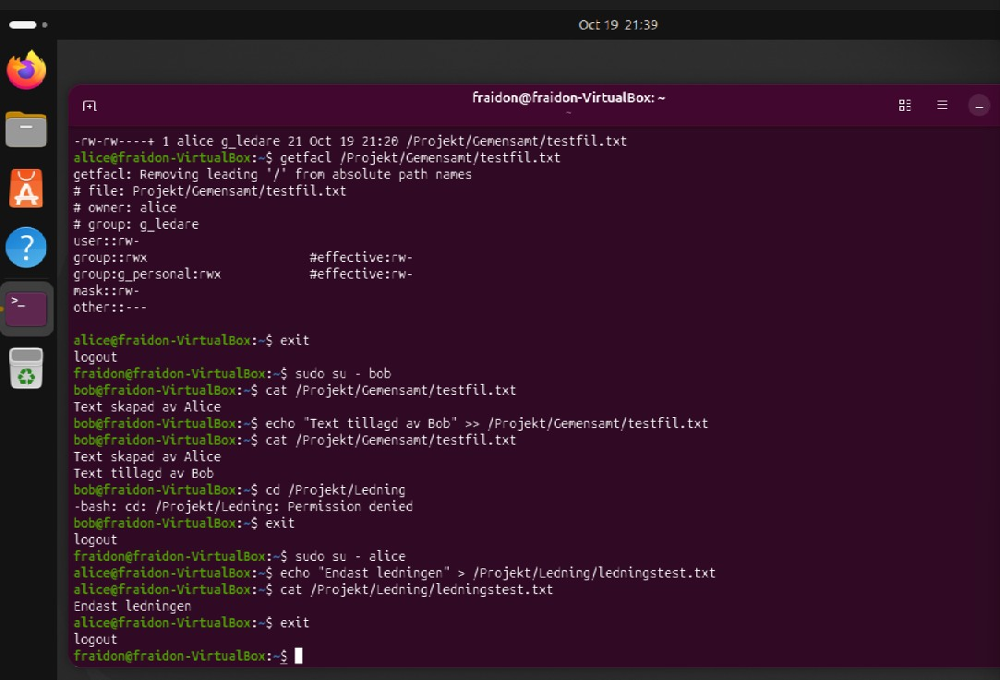

#### Windows – filägare och arv

Alice äger filen hon skapade i Gemensamt. Filen har ärvt
behörigheter för g_ledare och g_personal från mappen.

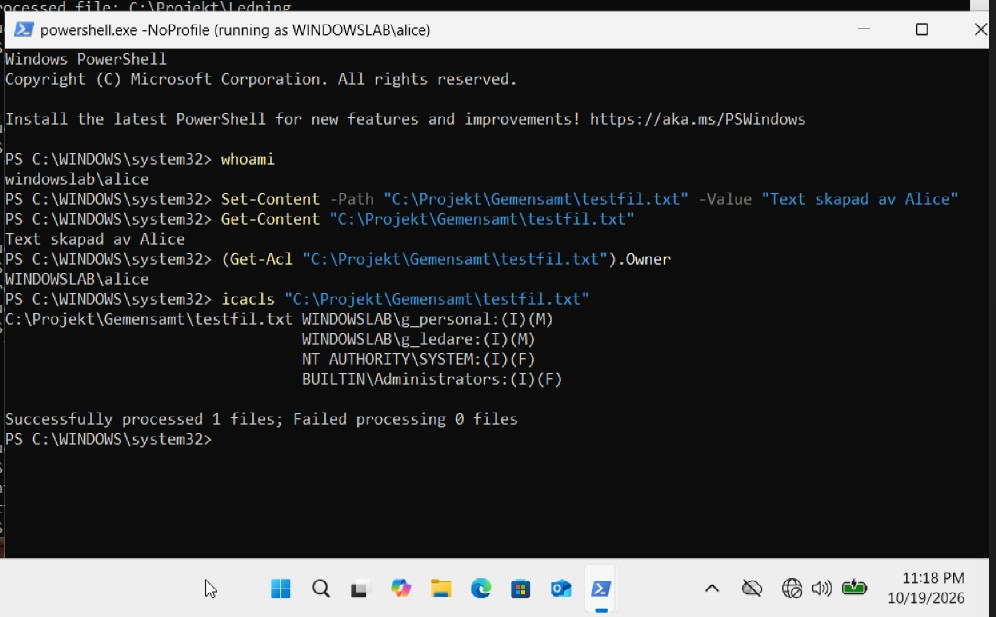

#### Windows – Bobs åtkomst

Bob kan läsa och ändra den gemensamma filen men nekas
åtkomst till Ledning.

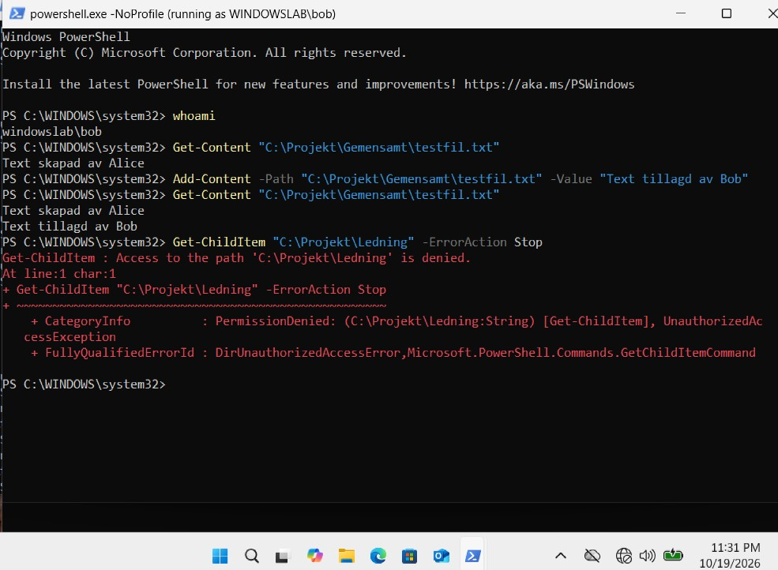

#### Windows – Alices åtkomst till Ledning

Alice kan skapa och läsa en fil i Ledning.

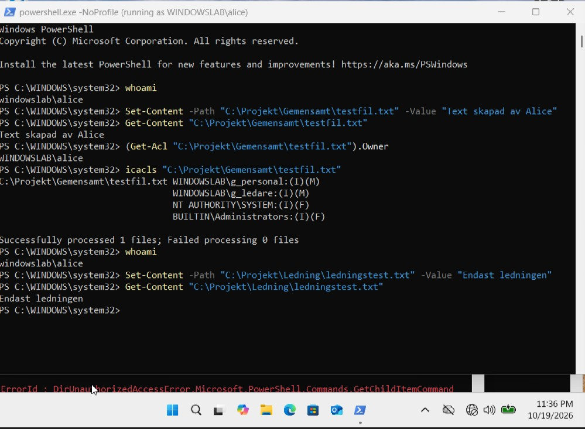

### Analys – behörigheter, arv och filägare

#### Linux

I Linux använde jag vanliga filrättigheter tillsammans med ACL.
ACL gör det möjligt att ge flera grupper åtkomst till samma mapp.

Gemensamt har gruppen g_ledare som ägargrupp. Gruppen g_personal
får åtkomst genom en extra ACL-post.

Jag aktiverade SetGID på mapparna. Det innebär att nya filer
ärver mappens ägargrupp. Standard-ACL ger nya filer och undermappar
behörigheter enligt mappens regler.

När Alice skapade testfilen blev alice filens ägare och
g_ledare dess ägargrupp. Bob kunde ändra filen genom gruppen
g_personals ACL-behörighet. Ägaren ändrades inte när Bob lade
till text.

På kataloger betyder x att användaren får passera in i katalogen.
Vanliga textfiler behöver däremot inte körbehörighet. Testfilens
ACL-mask begränsade gruppbehörigheterna till läsning och skrivning.

#### Windows

I Windows använde jag NTFS-behörigheter. Båda grupperna fick
Modify i Gemensamt. Modify omfattar läsning, skrivning och
radering.

Markeringarna (OI) och (CI) gör att behörigheterna ärvs av filer
respektive undermappar. I testfilens behörigheter visade (I)
att behörigheterna var ärvda.

När Alice skapade testfilen blev WINDOWSLAB\alice filens ägare.
Gruppernas åtkomst styrdes av filens ärvda behörighetsposter.
Windows använder inte en ägargrupp på samma sätt som Linux.

Ledning gav endast g_ledare åtkomst bland labbgrupperna.
Bob nekades åtkomst eftersom han saknade en tillåtande
behörighet. Jag behövde därför ingen uttrycklig Deny-regel.

SYSTEM och Administrators behöll fullständig behörighet för
administration av mapparna.

#### Slutsats

Båda systemen uppfyllde åtkomstkraven i testerna. Linux använde
SetGID för att ärva ägargrupp och standard-ACL för behörigheter.
Windows använde ärvda NTFS-behörigheter.

En skillnad är att Linux styr radering främst genom rättigheterna
på katalogen, medan Windows även har särskilda rättigheter för
radering. Samma testresultat innebär därför inte att systemen
hanterar alla situationer identiskt.

## A. Nätverksflöde

### Windowslabs nätverksanslutningar

Windowslab har två nätverksadaptrar i VirtualBox:

| Adapter | Anslutning | IPv4-adress | Subnät | Standardgateway |
|---|---|---|---|---|
| Ethernet | Internal Network: intnet | 192.168.1.50 | 192.168.1.0/24 | Ingen |
| Ethernet 2 | NAT | 10.0.3.15 via DHCP | 10.0.3.0/24 | 10.0.3.2 |

Ethernet används för det interna labbnätverket. Ethernet 2
används för internetåtkomst via VirtualBox NAT.

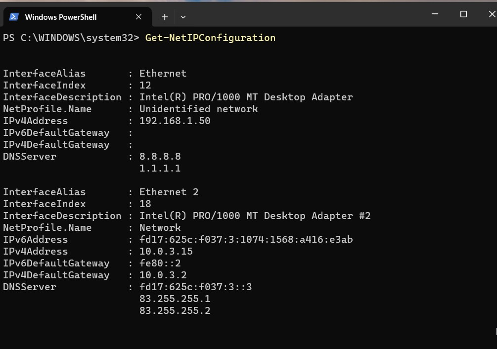

### Felsökning och verifiering

Först misslyckades namnuppslagningen för example.com med timeout.
Windowslab hade då endast en anslutning till det interna
nätverket intnet, som inte automatiskt ger internetåtkomst.

Jag lade till Adapter 2 med NAT och tog bort standardgatewayen
192.168.1.1 från labbadaptern. Labbets statiska IP-adress behölls.

Efter ändringen gav nslookup example.com svar från DNS-servern
8.8.8.8. Test-NetConnection example.com -Port 443 lyckades med
TcpTestSucceeded: True.

TCP-testet använde Ethernet 2 med källadressen 10.0.3.15 och
anslöt till 104.20.23.154 på port 443. Adressen var den som
användes vid testtillfället och kan ändras.

Testet bekräftar DNS-uppslagning och TCP-anslutning till port 443.
Det testar inte en fullständig HTTPS-förfrågan eller TLS-certifikatet.

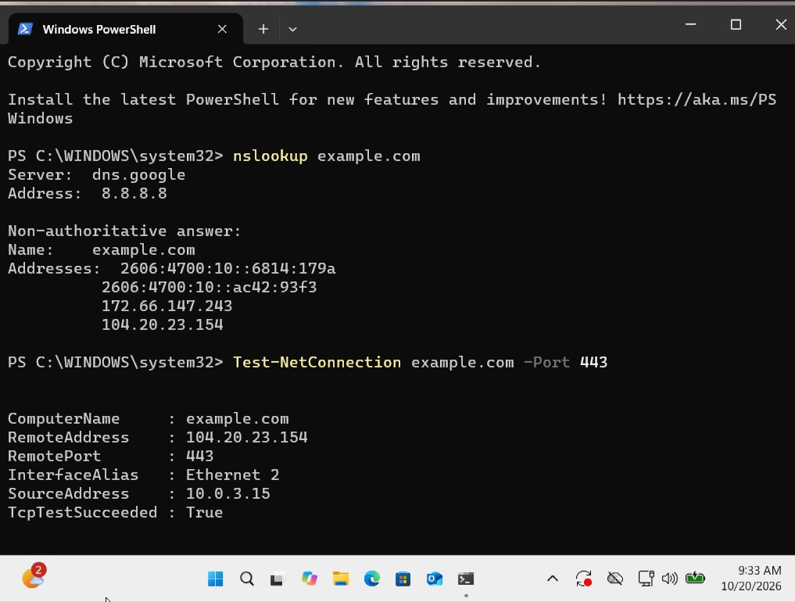

### Trafikdiagram – DNS och webbanslutning

Diagrammet visar IPv4-flödet. DNS-frågan och webbanslutningen
är separata anslutningar som båda går via gatewayen.

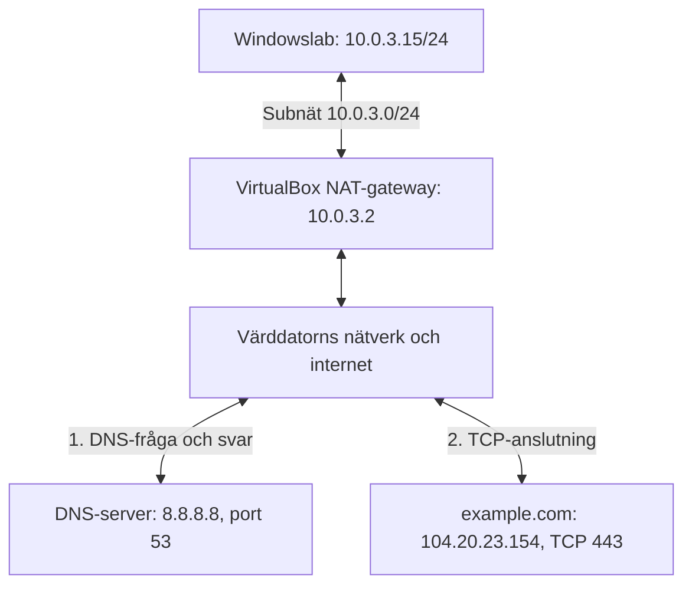

DNS-servern returnerar en IP-adress. Webbtrafiken skickas sedan
till webbservern och passerar inte genom DNS-servern.

### Trafikflödet steg för steg

1. Klienten frågar DNS-servern efter IP-adressen för example.com.
   Vanlig DNS använder normalt UDP-port 53, men kan även använda
   TCP-port 53.

2. Klienten jämför destinationens IP-adress med sitt eget subnät.
   Både 8.8.8.8 och webbserverns adress ligger utanför
   10.0.3.0/24. Trafiken skickas därför till gatewayen 10.0.3.2.

3. På det lokala virtuella Ethernet-nätet används ARP för att
   hitta gatewayens MAC-adress om den inte redan finns i cachen.
   Ethernet-ramen adresseras till gatewayens MAC-adress,
   medan IP-paketet adresseras till den externa servern.

4. VirtualBox NAT översätter den privata källadressen och
   vid behov källporten. Trafiken skickas vidare genom
   värddatorns nätverksanslutning. Ytterligare NAT kan ske
   i det fysiska nätverket.

5. Efter DNS-svaret öppnar klienten en TCP-anslutning till
   webbserverns IP-adress på port 443. Klienten använder en
   tillfällig källport. TCP upprättar anslutningen med
   SYN, SYN-ACK och ACK.

6. Vid ett vanligt HTTPS-besök sker därefter en TLS-handshake
   och krypterad HTTP-kommunikation. Mitt TCP-test verifierade
   endast att TCP-anslutningen kunde upprättas.

7. Svaren skickas tillbaka till klienten. NAT håller reda på
   anslutningen så att svaren når rätt virtuell maskin och port.

### MAC, IP och portar i TCP/IP-modellen

| Lager | Funktion i flödet |
|---|---|
| Applikation | DNS slår upp namn. HTTP över TLS används vid ett HTTPS-besök. |
| Transport | UDP eller TCP använder portar. DNS använder normalt port 53 och HTTPS över TCP använder port 443. |
| Internet | IP-adresser identifierar källa och destination. Routrar väljer nästa väg för paketen. |
| Nätverksåtkomst | Ethernet använder MAC-adresser för överföringen på den lokala länken. ARP kopplar IPv4-adress till MAC-adress. |

NAT-adapterns MAC-adress är 08-00-27-16-0D-33. Den används
på den virtuella lokala länken och följer inte med hela vägen
till webbservern. På varje ny Ethernet-länk används
MAC-adresserna för just den länken.

IP-adresserna är normalt desamma genom routningen, men NAT
ändrar adresser och kan även ändra portar. Destinationens
TCP-port är 443 i det verifierade webbservertestet.

## C. Drift, överlämning och återställning

### Systemöversikt

Labbmiljön körs i VirtualBox. Behörighetstesterna genomfördes
i WindowsLab och Ubuntu2.

| Resurs | WindowsLab | Ubuntu2 |
|---|---|---|
| Operativsystem | Windows 11, 64-bit | Ubuntu 26.04.1 LTS |
| Datornamn i operativsystemet | Windowslab | fraidon-VirtualBox |
| RAM | 4096 MB | 4096 MB |
| Processorer | 2 | 2 |
| Virtuell disk | WindowsLab.vdi, 80 GB | Ubuntu2.vdi, 40 GB |
| Diskkontroller | SATA | SATA |
| Firmware | EFI | EFI |
| Nätverk | intnet och NAT | NAT Network: NatNetwork |

Ubuntu-versionen verifierades med hostnamectl. Versionsetiketten
i VirtualBox motsvarade inte det installerade operativsystemet.

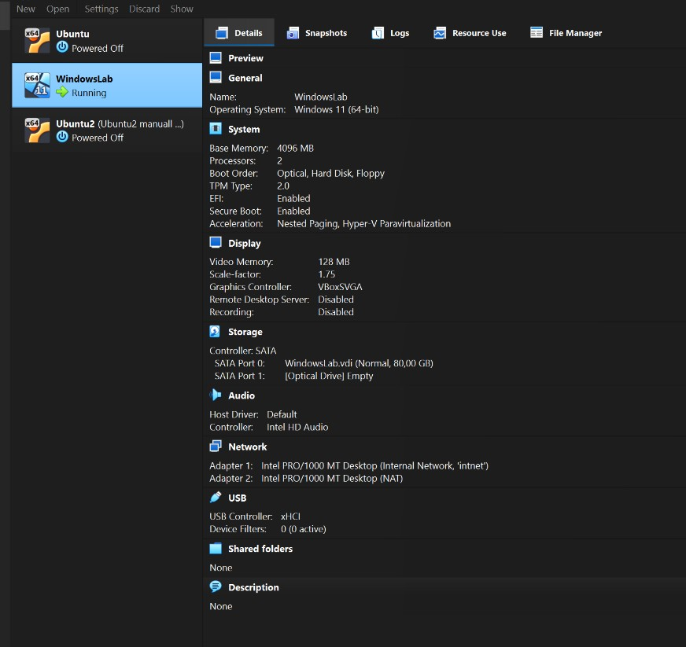

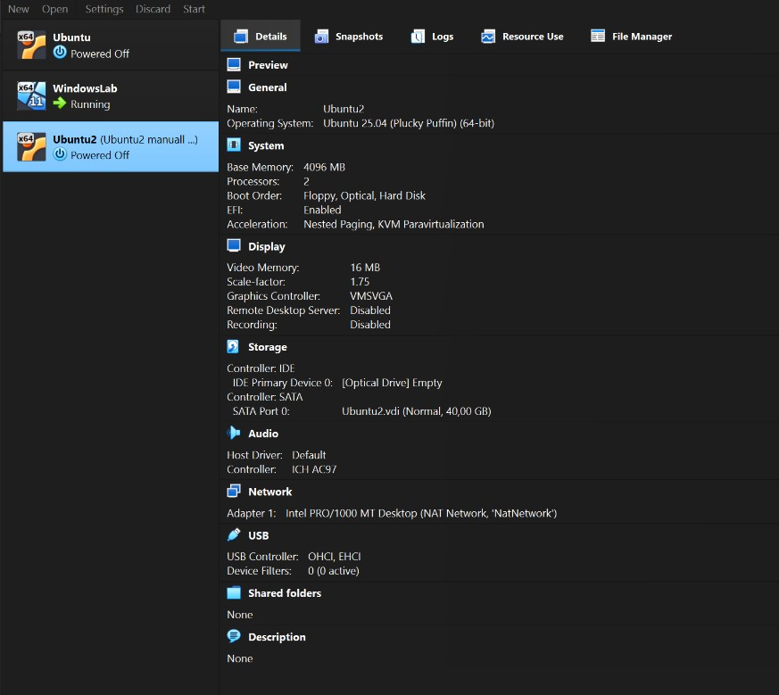

### Ubuntu2 – lagring

| Partition | Storlek enligt lsblk | Filsystem | Monteringspunkt |
|---|---|---|---|
| sda1 | 1G | FAT32 | /boot/efi |
| sda2 | 954M | ext4 | /boot |
| sda3 | 9.3G | ext4 | /var |
| sda4 | 1.9G | ext4 | /tmp |
| sda5 | 26.8G | ext4 | / |

Separata partitioner för /var och /tmp begränsar hur mycket
utrymme dessa kataloger kan ta från rotfilsystemet. Varje
partition behöver därför övervakas så att den inte blir full.


### Ubuntu2 – nätverkskonfiguration

Nätverkskortet enp0s3 använder profilen netplan-enp0s3
och hanteras av NetworkManager via Netplan.

- Statisk IPv4-adress: 192.168.50.3/24.
- DHCP för IPv4 är också aktiverat.
- Ytterligare adress vid kontrollen: 192.168.50.100/24.
- Standardgateway: 192.168.50.1.
- Manuellt angivna DNS-servrar: 1.1.1.1 och 8.8.8.8.

Den extra adressen bedöms komma från DHCP och kan ändras.
Konfigurationen innehåller gateway4, som Netplan varnar är
föråldrat. Vid en framtida uppdatering bör standardgatewayen
anges med routes och därefter verifieras.

Ubuntu2 och Windowslabs interna adapter är anslutna till
olika virtuella nätverk och subnät. Direkt kommunikation
mellan dessa två maskiner är inte verifierad i denna fördjupning.

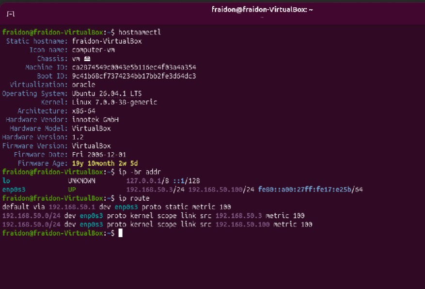


### Start, inloggning och avstängning

1. Öppna VirtualBox på värddatorn.
2. Starta WindowsLab eller Ubuntu2.
3. Logga in med administrationskontot Fraidon i Windows
   respektive fraidon i Ubuntu.
4. Använd alice och bob när behörigheter ska testas.
   Kontrollera aktuell användare med whoami.

Lösenord ska förvaras separat och lämnas över säkert.
De ska inte skrivas i dokumentationen eller sparas i Git.

Stäng av Windows genom Start → Av/på → Stäng av.
Stäng av Ubuntu genom systemmenyn eller sudo poweroff.
Vänta tills VirtualBox visar Powered Off.

### Kontroller vid drift och felsökning

| Kontroll | Ubuntu2 | WindowsLab |
|---|---|---|
| Ledigt diskutrymme | df -h | Get-Volume |
| IP-adresser | ip -br addr | Get-NetIPConfiguration |
| Routning | ip route | route print -4 |
| DNS | resolvectl status | nslookup example.com |
| Användarens grupper | id alice och id bob | Get-LocalGroupMember g_ledare och Get-LocalGroupMember g_personal |
| Behörigheter | getfacl /Projekt/Gemensamt /Projekt/Ledning | icacls C:\Projekt\Gemensamt och icacls C:\Projekt\Ledning |

Kör Windows gruppkontroller i PowerShell. Administrativa
åtgärder kräver ett förhöjt PowerShell-fönster. I Ubuntu
används sudo när kommandot kräver administratörsbehörighet.

Vid nätverksfel kontrolleras först VirtualBox-adapter och
anslutet nätverk, därefter IP-adress, nätmask, gateway och DNS.
Ett uteblivet pingsvar behöver inte betyda att all trafik är
blockerad. Testa även den aktuella tjänstens TCP-port.

Vid behörighetsfel kontrolleras aktuell användare,
gruppmedlemskap och rättigheterna på både fil och överordnade
mappar. Efter ändrat gruppmedlemskap bör användaren logga
ut och in innan ett nytt test.

### Planerad säkerhetskopiering

Följande är en rutin för kommande säkerhetskopiering.
En genomförd och verifierad VM-säkerhetskopia är ännu
inte dokumenterad i denna rapport.

1. Stäng av VM:erna normalt och kontrollera Powered Off.
2. Högerklicka på respektive VM i VirtualBox och välj
   Show in Explorer för att hitta maskinens filer.
3. Kopiera hela VM-mappen till en separat säkerhetskopieringsdisk.
   Ta med konfiguration, virtuella diskar och eventuell
   Snapshots-mapp. Om en disk ligger utanför VM-mappen
   måste även den kopieras.
4. Märk säkerhetskopian med maskinnamn och datum.
5. Kontrollera att kopieringen slutförts utan fel.
6. Verifiera säkerhetskopian genom ett återställningstest
   innan den betraktas som fungerande.

Säkerhetskopiering bör göras efter större ändringar och
regelbundet under fortsatt arbete. Behåll en tidigare
fungerande kopia tills den nya har verifierats.

Snapshots kan användas före ändringar för snabb återgång,
men ersätter inte en separat säkerhetskopia. Återgång till
en snapshot kan ta bort senare ändringar i VM:en.

Markdown, skript och bevisbilder versionshanteras i Git.
Git säkerhetskopierar inte VM:ernas diskar eller användarnas
projektfiler inne i maskinerna.

### Återställning från VM-säkerhetskopia

Denna rutin beskriver planerad återställning.
Ett fullständigt återställningstest är ännu inte genomfört.

1. Kontrollera säkerhetskopians datum och välj den version
   som ska återställas. Stäng av den berörda VM:en.
2. Behåll den befintliga VM-mappen tills återställningen
   har verifierats. Kopiera säkerhetskopian till en separat
   återställningsmapp på värddatorn.
3. Om originalmaskinen fortfarande är registrerad i VirtualBox,
   välj Remove och därefter Remove only. Välj inte att radera
   maskinens filer.
4. Välj Open eller Add i VirtualBox och öppna den återställda
   maskinens .vbox-fil.
5. Kontrollera RAM, processorer, EFI, diskar och nätverksadaptrar
   mot systemöversikten. För WindowsLab kontrolleras även
   TPM 2.0 och Secure Boot.
6. Kontrollera att Ubuntu2:s NAT Network med namnet NatNetwork
   finns och använder subnätet 192.168.50.0/24.
   WindowsLabs Adapter 1 ska använda intnet och Adapter 2 NAT.
7. Starta den återställda VM:en och kontrollera inloggning,
   filer, nätverk och behörigheter enligt checklistan nedan.
8. Dokumentera datum, använd säkerhetskopia, testresultat
   och eventuella avvikelser.

Starta inte originalet och den återställda kopian samtidigt
i samma nätverk. De kan ha samma IP-adresser och identiteter.

### Kontroll efter återställning

| Kontroll | Förväntat resultat |
|---|---|
| Administratörsinloggning | Fungerar i båda operativsystemen |
| Projektmappar | Gemensamt och Ledning finns |
| Gruppmedlemskap | alice tillhör g_ledare och bob tillhör g_personal |
| Gemensamt | Alice och Bob kan läsa och ändra samma testfil |
| Ledning | Alice kan skapa och läsa en fil, Bob nekas åtkomst |
| Linux filägare och ACL | Ägare, ägargrupp, SetGID och ACL motsvarar dokumentationen |
| Windows NTFS | Gruppbehörigheter och arv motsvarar dokumentationen |
| Windows DNS | nslookup example.com ger ett svar |
| Windows internetanslutning | Test-NetConnection example.com -Port 443 visar TcpTestSucceeded: True |
| Lagring | Förväntade partitioner finns och har ledigt utrymme |

### Återskapande utan fungerande VM-säkerhetskopia

Om säkerhetskopia saknas behöver operativsystemen installeras
på nytt med resurserna i systemöversikten.

Ubuntu2:s partitioner återskapas enligt partitionstabellen.
WindowsLab använder NTFS för projektmapparna. Därefter
återskapas nätverksinställningar, användare, grupper och
behörigheter.

Konfigurationsskript kan återskapa inställningar men ersätter
inte säkerhetskopior av filernas innehåll. Befintliga
projektfiler behöver återställas separat.

Efter ominstallation kan användarnas UID/GID i Linux och SID
i Windows skilja sig från tidigare. Ägarskap och behörigheter
på återställda filer måste därför kontrolleras.

### Överlämning

Den tekniker som tar över behöver:

- Denna dokumentation och tillhörande bevisbilder.
- Konfigurationsskript och information om deras teststatus.
- Tillgång till VirtualBox och operativsystemens installationsmedia.
- Administrationslösenord via en separat säker kanal.
- Säkerhetskopiornas plats, datum och verifieringsstatus.

Kända begränsningar vid dokumentationstillfället:

- Fullständig VM-återställning är inte testad.
- Ubuntu2 använder både statisk IPv4-adress och DHCP.
- Netplan-konfigurationen innehåller den föråldrade inställningen gateway4.
- Direkt kommunikation mellan Ubuntu2 och WindowsLab är inte verifierad.

### Linux – konfigurationsskript och verifiering

[Skript för Linux-behörigheter](scripts/linux-behorigheter.sh)

Skriptet skapar saknade användare och grupper samt konfigurerar
projektmapparnas ägare, rättigheter, SetGID och standard-ACL.
Befintliga filers innehåll och lösenord ändras inte.
Tidigare utökade ACL på de tre projektmapparna ersätts.

Skriptet överfördes via en skrivskyddad delad VirtualBox-mapp.

Syntaxkontroll:

```bash
sudo bash -n /media/sf_scripts/linux-behorigheter.sh
```

Körning:

```bash
sudo bash /media/sf_scripts/linux-behorigheter.sh
```

Både syntaxkontrollen och körningen gav avslutningskod 0.
Testet genomfördes i den befintliga Ubuntu2-miljön, där
användarna redan fanns. Skapande av konton på en ny installation
är därför inte verifierat.

Efter körningen skapade Alice en ny fil i Gemensamt.
Bob kunde läsa och lägga till text i samma fil.
Bob nekades åtkomst till Ledning.

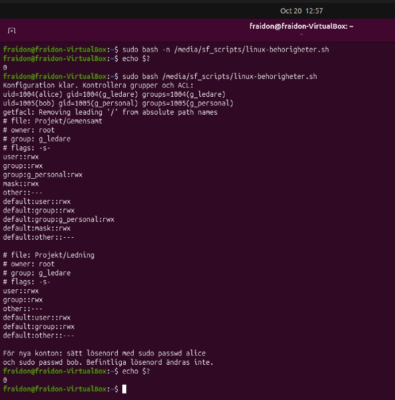

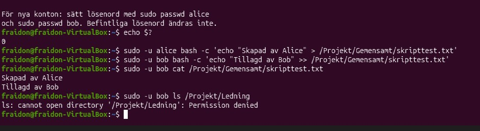

### Windows – konfigurationsskript och verifiering

Skript: [windows-behorigheter.ps1](scripts/windows-behorigheter.ps1)

Skriptet konfigurerar grupperna `g_ledare` och `g_personal`,
användarnas gruppmedlemskap samt behörigheterna för `C:\Projekt`,
`Gemensamt` och `Ledning`. Befintliga lösenord ändras inte.

Skriptet kopierades till Documents i WindowsLab och kördes i
Windows PowerShell som administratör:

```powershell
cd "$HOME\Documents"
Set-ExecutionPolicy -Scope Process -ExecutionPolicy RemoteSigned
.\windows-behorigheter.ps1
```

Ändringen av körningspolicyn gällde endast den aktuella
PowerShell-sessionen.

Efter skriptkörningen verifierades följande med separata
PowerShell-fönster startade som Alice respektive Bob:

- Alice skapade `Gemensamt\skripttest.txt` och blev filens ägare.
- Filen ärvde Modify-behörighet för båda grupperna.
- Bob kunde läsa filen och lägga till text i samma fil.
- Bob nekades åtkomst till `C:\Projekt\Ledning`.
- Alice kunde skapa och läsa `Ledning\skripttest-ledning.txt`.

Testerna utfördes med befintliga labbkonton. Skapande av nya
konton på en nyinstallerad Windows-maskin har inte verifierats.

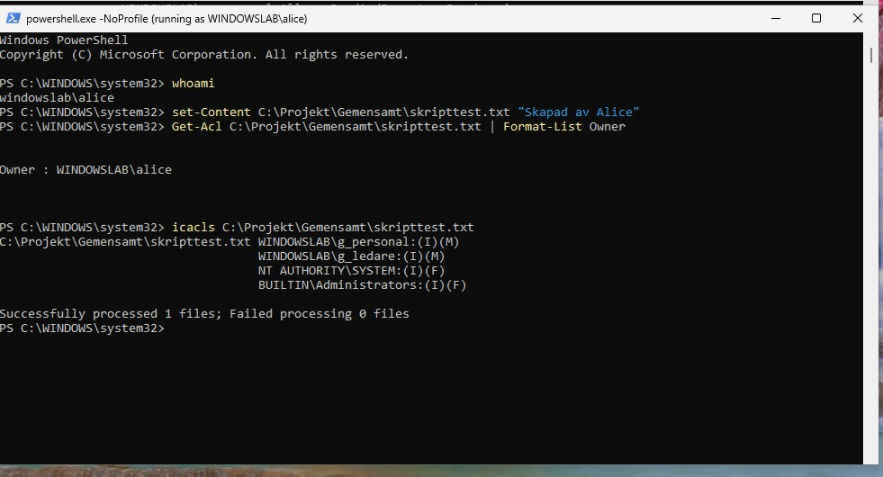

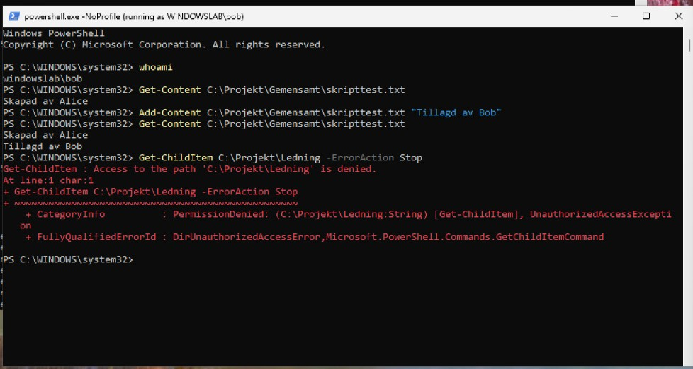

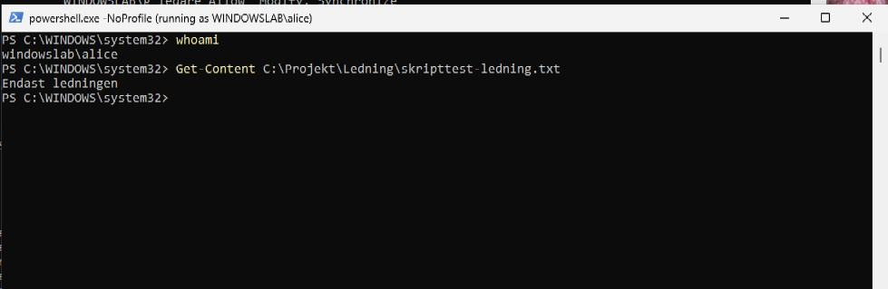

### Förberedelser vid återskapande av behörigheter

Följande instruktioner gäller vid ominstallation. En fullständig
ominstallation och återställning har inte testats.

#### Ubuntu2

1. Återskapa nätverksanslutningen och kontrollera internetåtkomst.
2. Installera ACL-verktygen:

```bash
sudo apt update
sudo apt install acl
```

3. Kopiera `scripts/linux-behorigheter.sh` från Git-projektet
   till Ubuntu2. Öppna en terminal i mappen med skriptet.
4. Kontrollera syntaxen och kör sedan skriptet:

```bash
bash -n linux-behorigheter.sh
sudo bash linux-behorigheter.sh
```

5. Om skriptet har skapat nya konton behöver de få lösenord
   innan interaktiv inloggning kan användas:

```bash
sudo passwd alice
sudo passwd bob
```

6. Upprepa behörighetstesterna som Alice och Bob.

#### WindowsLab

1. Kopiera `scripts/windows-behorigheter.ps1` från Git-projektet
   till Documents i WindowsLab.
2. Öppna 64-bitars Windows PowerShell som administratör.
3. Kör enligt avsnittet Windows – konfigurationsskript och verifiering.
4. Om kontona saknas frågar skriptet efter lösenord för de nya kontona.
5. Starta separata PowerShell-fönster med `runas` för Alice och Bob
   och upprepa behörighetstesterna.

Skripten återställer projektmapparnas behörigheter. De återställer
inte tidigare filinnehåll. Återställda filer måste kontrolleras
separat avseende ägare och behörigheter.

### Återskapa WindowsLabs nätverk efter ominstallation

Följande är en återuppbyggnadsrutin baserad på den dokumenterade
konfigurationen. Rutinen har inte testats genom en fullständig
ominstallation.

1. Stäng av WindowsLab.
2. Öppna maskinens nätverksinställningar i VirtualBox:
   - Adapter 1: aktiverad, Internal Network, namn `intnet`.
   - Adapter 2: aktiverad, NAT.
   - Cable Connected ska vara markerat för båda.
3. Starta WindowsLab. Kör `ncpa.cpl` via Windows + R
   för att öppna nätverksanslutningarna.
4. Identifiera vilken Windows-anslutning som motsvarar respektive
   VirtualBox-adapter genom att jämföra MAC-adresserna.
   Anslutningarnas namn kan skilja sig efter ominstallation.
5. Öppna den interna anslutningens Properties och sedan
   Internet Protocol Version 4 (TCP/IPv4). Ange:
   - IP-adress: `192.168.1.50`
   - Nätmask: `255.255.255.0`
   - Standardgateway: lämnas tom
   - Föredragen DNS: `8.8.8.8`
   - Alternativ DNS: `1.1.1.1`
6. På NAT-anslutningen väljs automatisk tilldelning av både
   IP-adress och DNS-server.
7. Kontrollera konfigurationen i PowerShell:

```powershell
Get-NetIPConfiguration
nslookup example.com 8.8.8.8
Test-NetConnection example.com -Port 443
```

NAT-anslutningen ska få adress och gateway via DHCP.
Vid det dokumenterade testet var dessa `10.0.3.15/24`
respektive `10.0.3.2`. Kontrollera de faktiskt tilldelade
värdena efter ominstallationen.

DNS-testet ska ge svar och TCP-testet ska visa
`TcpTestSucceeded: True`. Detta verifierar inte kommunikation
mellan WindowsLab och Ubuntu2.

### Återskapa Ubuntu2:s nätverk efter ominstallation

Nedan återges nätverksinställningarna från den befintliga miljön.
Återuppbyggnadsrutinen har inte testats genom en ominstallation.

#### VirtualBox

Ubuntu2:s Adapter 1 ska vara ansluten till NAT Network
med namnet `NatNetwork`. Nätverket ska använda
`192.168.50.0/24`, gateway `192.168.50.1` och ha DHCP aktiverat.

#### Netplan-filer

Konfigurationen ligger i tre filer under `/etc/netplan/`.
Följande visar deras nätverksinställningar. Kommentarer och
NetworkManagers extra metadata har utelämnats.

`00-installer-config.yaml`:

```yaml
network:
  version: 2
  ethernets:
    enp0s3:
      dhcp4: true
      dhcp6: true
      match:
        macaddress: "08:00:27:17:e2:5b"
      set-name: enp0s3
```

`01-network-manager-all.yaml`:

```yaml
network:
  version: 2
  renderer: NetworkManager
```

`90-NM-1eef7e45-3b9d-3043-bee3-fc5925c90273.yaml`:

```yaml
network:
  version: 2
  ethernets:
    enp0s3:
      renderer: NetworkManager
      match: {}
      addresses:
        - 192.168.50.3/24
      nameservers:
        addresses:
          - 1.1.1.1
          - 8.8.8.8
      gateway4: 192.168.50.1
      dhcp6: true
      networkmanager:
        uuid: "1eef7e45-3b9d-3043-bee3-fc5925c90273"
        name: "netplan-enp0s3"
```

#### Återuppbyggnadsrutin

1. Arbeta via VirtualBox-konsolen.
2. Kontrollera nätverkskortets namn och MAC-adress:

```bash
ip -br link
```

3. Säkerhetskopiera den nya installationens befintliga
   Netplan-konfiguration innan den ersätts:

```bash
sudo cp -a /etc/netplan /etc/netplan-fore-aterstallning
```

4. Återskapa filerna ovan med exempelvis `sudo nano`.
   Flytta eventuella andra YAML-filer för samma nätverkskort
   till säkerhetskopieringsmappen så att de inte ger
   motstridiga inställningar.
5. Anpassa MAC-adressen till det faktiska nätverkskortet.
   Anpassa även kortnamnet om det skiljer sig från `enp0s3`.
6. Sätt filernas ägare och rättigheter:

```bash
sudo chown root:root /etc/netplan/*.yaml
sudo chmod 600 /etc/netplan/*.yaml
```

7. Prova konfigurationen:

```bash
sudo netplan try
```

Kontrollera anslutningen innan ändringen bekräftas.
Om nätverket inte fungerar ska den tidigare konfigurationen
återställas och kontrolleras från konsolen.

8. Verifiera adresser, routning och DNS:

```bash
ip -br addr
ip route
resolvectl status
resolvectl query example.com
```

Den statiska adressen ska vara `192.168.50.3/24`.
DHCP kan dessutom tilldela en adress som skiljer sig från
den tidigare observerade `192.168.50.100`.

Inställningen `gateway4` återges för att motsvara den befintliga
miljön. Den ger en varning om föråldrad syntax och bör vid en
separat, verifierad uppdatering ersättas med `routes`.